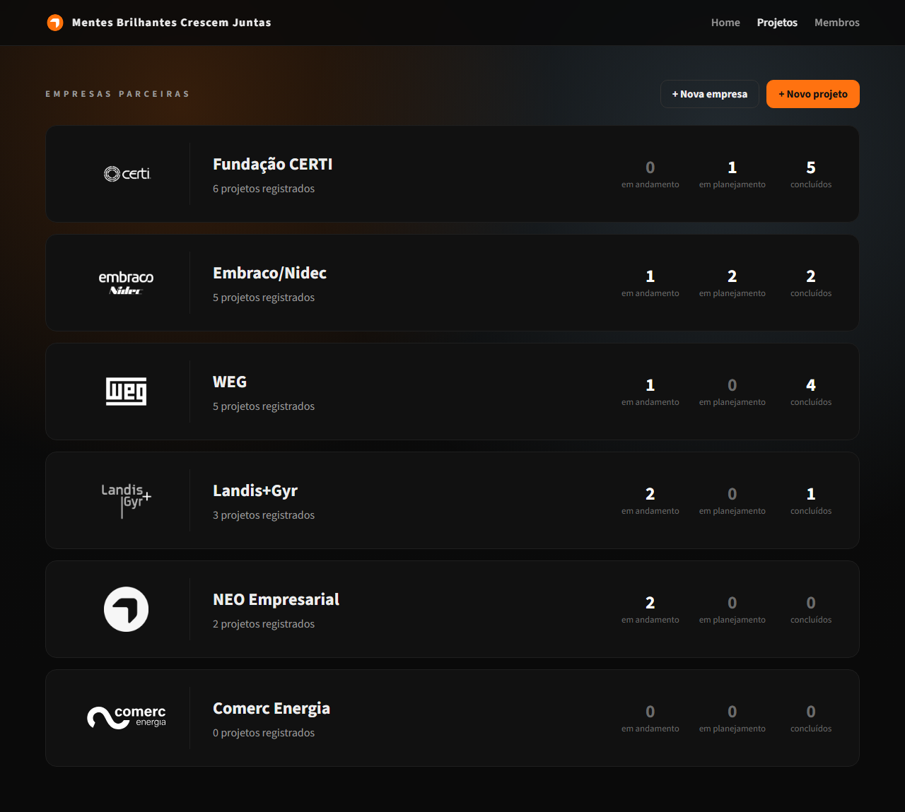
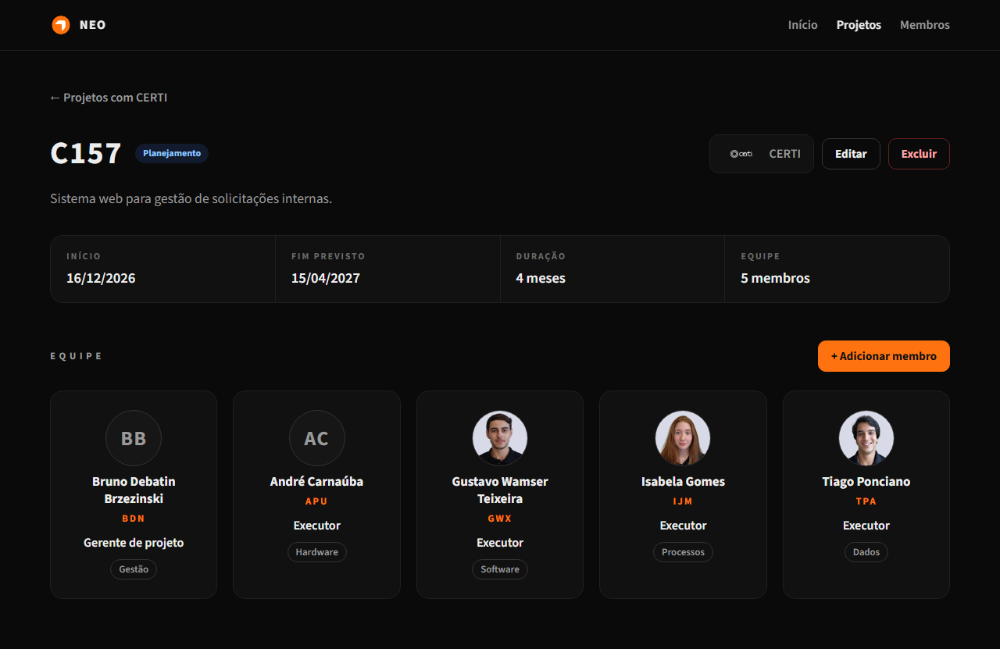
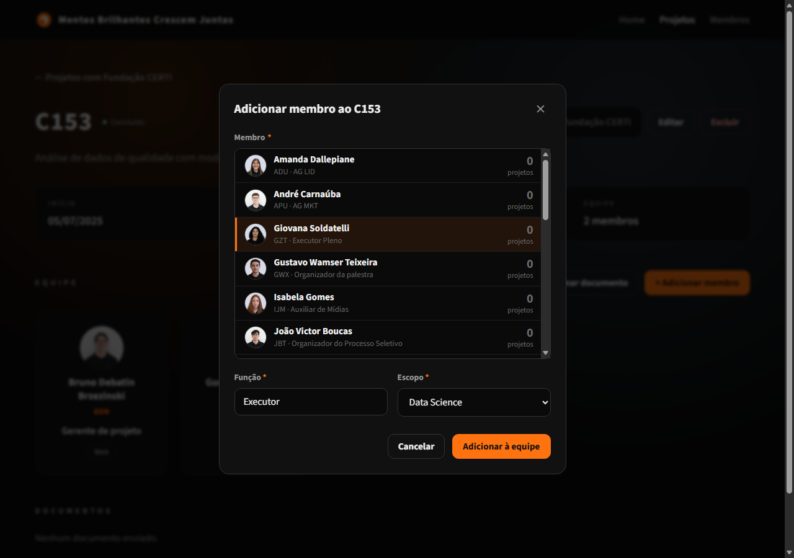
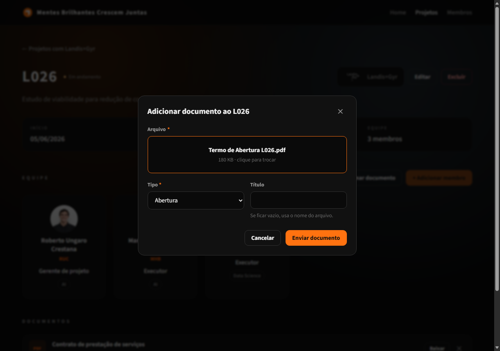

# Projeto Final MWD — Hub de Projetos do NEO

Sistema web para acompanhar os projetos que o NEO realizou e está realizando com as
**empresas parceiras (EPs)** e a **equipe de membros** alocada em cada projeto.

- **Frontend:** React 19 + Vite + React Router, CSS puro com tema escuro
- **Backend:** API REST com Django 6 + Django REST Framework, banco SQLite


## Funcionalidades

- **Início:** números gerais, projetos em andamento, backlog (projetos em planejamento) e EPs.
- **Empresas parceiras:** grade com a logo e a quantidade de projetos de cada EP; cadastro,
  edição e exclusão (uma EP com projetos não pode ser excluída).
- **Projetos por EP:** ao clicar numa EP, lista os projetos do NEO com ela, com status e datas.
- **Detalhes do projeto:** descrição, datas, duração e equipe; criar, editar e excluir projetos.
  Ao criar, o nome é sugerido pela sequência da EP (ex.: depois do L027 vem o L028; sempre com 3 dígitos).
- **Equipe:** adicionar membros ao projeto (com função e escopo), editar e remover.
- **Documentos:** enviar arquivos do projeto (abertura, contrato, proposta, relatório, ata...), abrir, baixar e excluir.
- **Membros:** lista com busca por nome ou sigla, perfil com os projetos de cada membro,
  cadastro, edição e exclusão.

## Telas

| Empresas parceiras | Projetos de uma EP |
|---|---|
|  |  |

| Detalhes do projeto | Novo projeto |
|---|---|
|  |  |

| Adicionar membro (por capacidade) | Adicionar documento |
|---|---|
|  |  |

| Membros | Perfil do membro |
|---|---|
|  |  |

## Como rodar

### Backend

```powershell
cd backend
python -m venv venv
.\venv\Scripts\Activate
pip install -r requirements.txt
python manage.py migrate                  # cria o banco e as 5 EPs iniciais com logos
python manage.py importar_membros         # carga inicial dos membros atuais (API do NEO)
python manage.py criar_projetos_exemplo   # (opcional) projetos e alocações FICTÍCIOS
python manage.py runserver                # http://127.0.0.1:8000/api/
```

- `importar_membros` é só para a carga inicial: rodar de novo sobrescreve nome, e-mail e foto
  de quem tem a mesma sigla. Use `--todos` para incluir membros inativos.
- `criar_projetos_exemplo` recusa rodar se já houver projetos; `--limpar` apaga **todos** os
  projetos (e alocações) antes de recriar os exemplos.
- Admin do Django: `python manage.py createsuperuser` e depois `http://127.0.0.1:8000/admin/`.

### Frontend

```bash
cd frontend
npm install
npm run dev        # http://localhost:5173
```

O backend precisa estar rodando. Em desenvolvimento, o Vite repassa as chamadas `/api/...`
para `http://127.0.0.1:8000` (ver `vite.config.js`), então o frontend funciona em qualquer porta.

### Testes e verificação

```powershell
cd backend
python manage.py test api      # 40 testes da API, models e comandos
```

```bash
cd frontend
npm run lint                   # oxlint
npm run build                  # build de produção em dist/
```

## Modelo de dados

Baseado no diagrama `Tabelas Relacionais.pdf`:

```
empresas_parceiras 1 ──── * projetos 1 ──── * alocacoes * ──── 1 membros
```

| Tabela | Campos principais | Regras |
|---|---|---|
| `empresas_parceiras` | nome, logo_url | nome único |
| `projetos` | nome, descricao, empresa, status, data_inicio, data_fim_prevista | status: planejamento, em andamento ou concluído; fim não pode ser antes do início |
| `membros` | sigla, nome, email, foto_url | sigla com 3 letras maiúsculas e única; e-mail válido e único |
| `alocacoes` | membro, projeto, funcao, escopo | escopo: Web, Data Science, Business Intelligence, Visão Computacional ou AI; no máximo 3 membros por projeto; excluir projeto ou membro remove as alocações |

## API

Base: `http://127.0.0.1:8000/api/` (navegável pelo navegador, via Django REST Framework).

| Recurso | Endpoints | Filtros e campos extras |
|---|---|---|
| Empresas | `/empresas/`, `/empresas/<id>/` | `total_projetos`; ordenadas pela quantidade de projetos |
| Projetos | `/projetos/`, `/projetos/<id>/` | `?empresa=<id>`; `empresa_nome`, `empresa_logo_url`, `status_display` |
| Membros | `/membros/`, `/membros/<id>/` | `total_projetos`; sigla e e-mail normalizados |
| Alocações | `/alocacoes/`, `/alocacoes/<id>/` | `?projeto=<id>`, `?membro=<id>`; dados do membro, projeto e EP |
| Documentos | `/documentos/`, `/documentos/<id>/` | `?projeto=<id>`; upload em `multipart/form-data` (campo `arquivo`, até 20 MB) |

Todos aceitam `GET`, `POST`, `PUT`, `PATCH` e `DELETE`.

## Estrutura

```
backend/
├── config/                  configurações do Django (settings, urls)
└── api/
    ├── models.py            tabelas
    ├── serializers.py       conversão para JSON e validações
    ├── views.py             endpoints e filtros
    ├── tests.py             testes
    ├── migrations/          estrutura do banco + carga das EPs e logos
    └── management/commands/ importar_membros, criar_projetos_exemplo

frontend/
├── public/logos/            logos das EPs (SVG com fundo transparente)
└── src/
    ├── App.jsx              rotas
    ├── index.css            tema escuro (cores em variáveis no :root)
    ├── api/useApi.js        Axios (baseURL do backend), funções CRUD e hook useApi
    ├── hooks/               useFormulario (formulários)
    ├── components/          Layout, cards, Modal, Campo, Avatar...
    ├── pages/               uma página por tela
    └── utils/formatar.js    datas, duração, iniciais

docs/prints/                 imagens deste README
```

## Observações

- **Logos:** ficam em `frontend/public/logos/` e são cadastradas pelo caminho (ex.: `/logos/weg.svg`).
  Use SVG ou PNG com fundo transparente: o CSS deixa todas brancas para o tema escuro.
- **Fotos dos membros:** podem ficar em `frontend/public/membros/<sigla>.webp` (quadradas, 400×400) e
  são cadastradas como `/membros/<sigla>.webp`; o `importar_membros` usa essas fotos automaticamente.
  Links do Google Drive só aparecem se o arquivo estiver compartilhado com "Qualquer pessoa com o
  link". Sem foto, o site mostra as iniciais do nome.
- **Documentos enviados:** ficam em `backend/media/` e, como o banco, não vão para o Git.
- **Banco de dados:** o `db.sqlite3` não vai para o Git. Cada pessoa gera o seu com os comandos acima.
