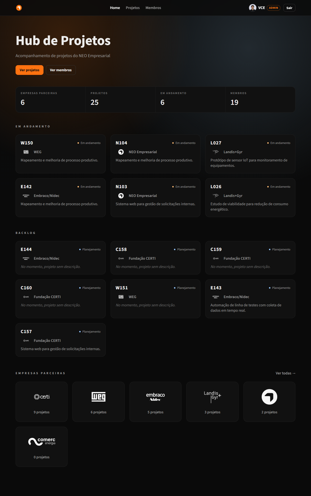
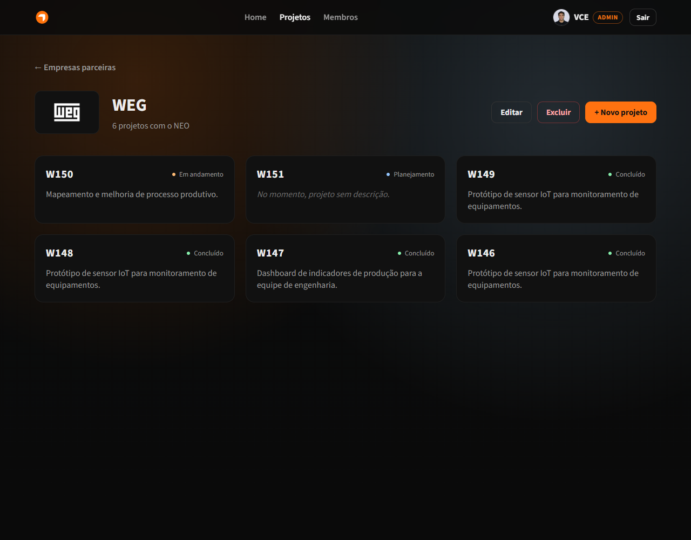
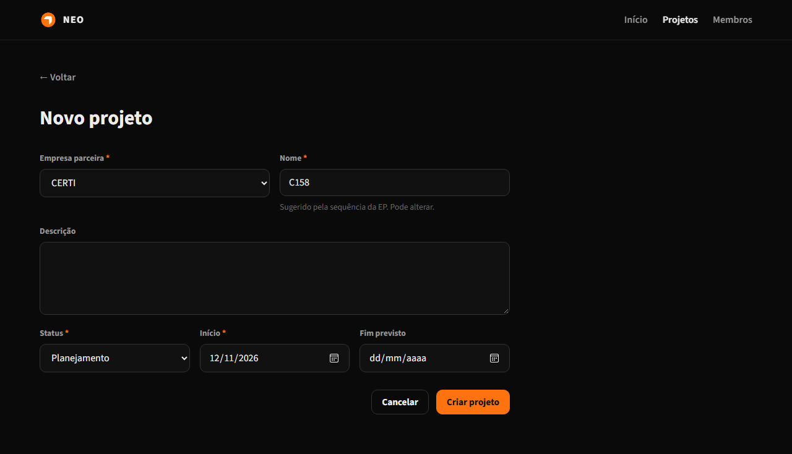
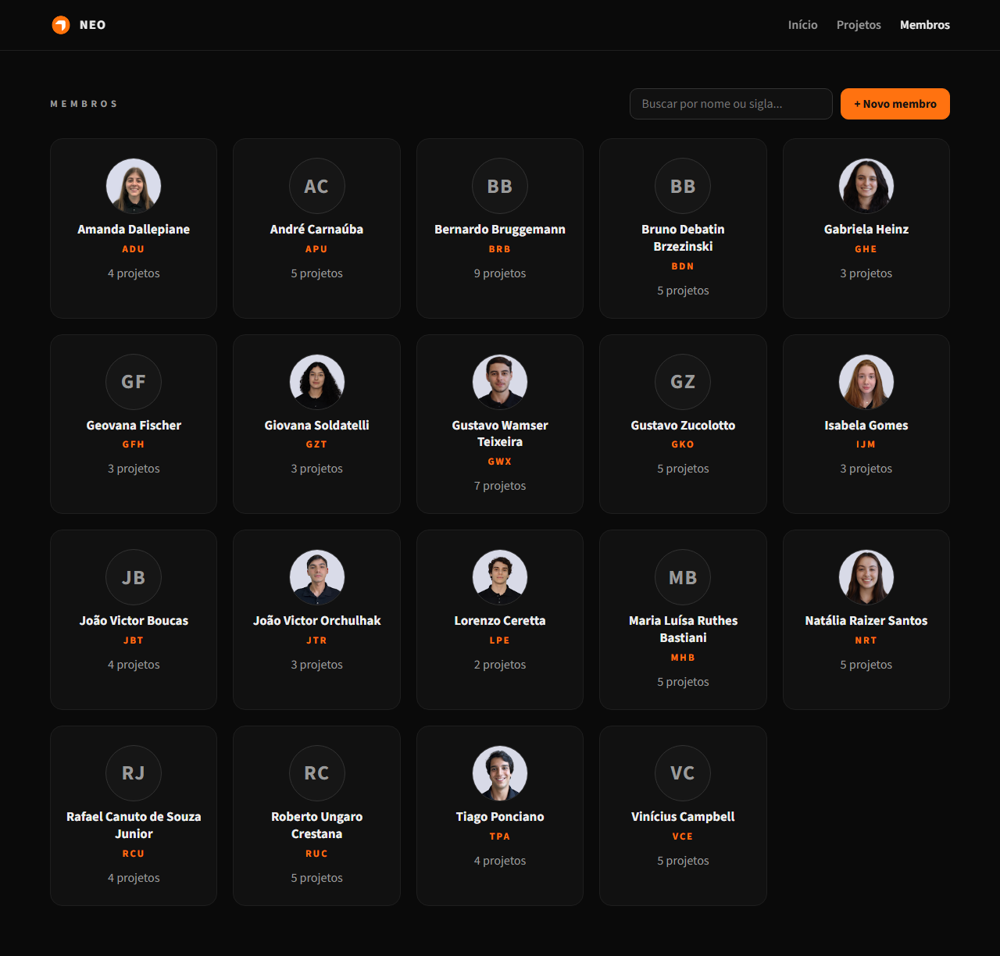
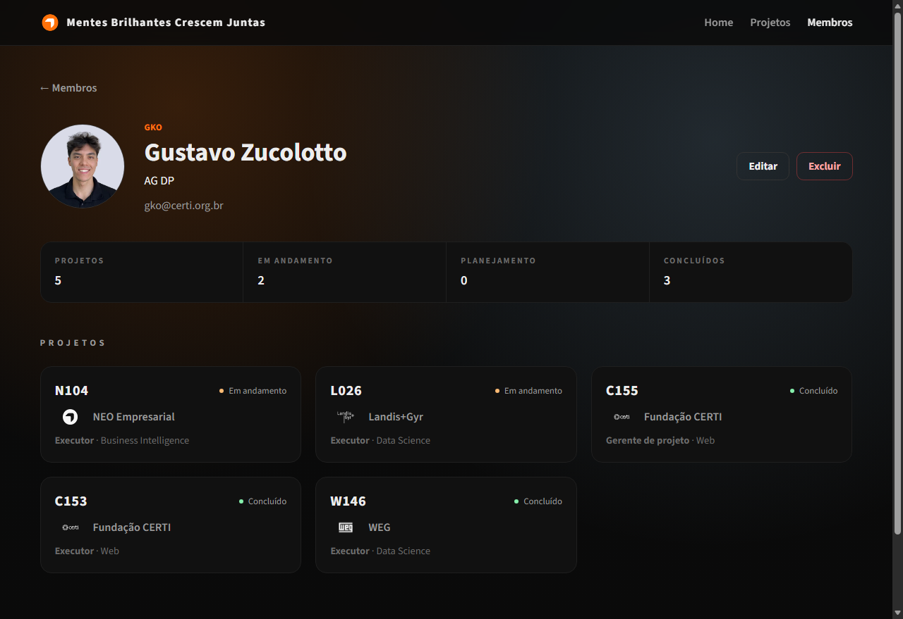

# Projeto Final MWD: Hub de Projetos do NEO

Aplicação web para acompanhar os projetos que o NEO realizou e está realizando com as
**empresas parceiras (EPs)** e a **equipe de membros do grupo** alocada em cada projeto.

- **Frontend:** React 19 + Vite + React Router + TanStack Query (cache das requisições), CSS puro com tema escuro
- **Backend:** API REST com Django 6 + Django REST Framework, banco SQLite



## Funcionalidades

- **Início:** números gerais, projetos em andamento, backlog (projetos em planejamento) e EPs.
- **Empresas parceiras:** grade com a logo e a quantidade de projetos de cada EP; cadastro,
  edição e exclusão (uma EP com projetos não pode ser excluída).
- **Projetos por EP:** ao clicar numa EP, lista os projetos do NEO com ela, com status e datas.
- **Detalhes do projeto:** descrição, datas, duração e equipe; criar, editar e excluir projetos.
  Ao criar, o nome é sugerido pela sequência da EP (ex.: depois do L027 vem o L028; sempre com 3 dígitos).
- **Equipe:** adicionar membros ao projeto (com função e escopo), editar e remover.
- **Documentos:** enviar arquivos do projeto (abertura, contrato, proposta, relatório, ata...), baixar e
  excluir. Cada documento aparece como um card com a **prévia da primeira página** (ou parte da imagem);
  clicar na prévia abre o documento completo na própria página: PDF, imagens (PNG/JPG), TXT, CSV e
  Excel (.xlsx) em tabela, Word (.docx) e a lista de arquivos de um ZIP. Os demais formatos (.doc,
  .xls, PowerPoint, OpenDocument) oferecem o download.
- **Membros:** lista com busca por nome ou sigla, perfil com os projetos de cada membro,
  cadastro, edição e exclusão.
- **Login e controle de acesso:** só membros do NEO entram (e-mail + senha, JWT). O que cada um
  pode fazer depende do papel (Admin ou Membro) e da função no projeto (Gerente de projeto ou Executor) — ver
  [Controle de acesso](#controle-de-acesso).

## Telas


| Empresas parceiras | Projetos de uma EP |
|---|---|
|  |  |

| Detalhes do projeto | Novo projeto |
|---|---|
|  |  |

| Adicionar membro (por capacidade produtiva) | Adicionar documento |
|---|---|
|  |  |

| Membros | Perfil do membro |
|---|---|
|  |  |

## Como rodar

### Backend

```powershell
cd backend
python -m venv venv
.\venv\Scripts\Activate
pip install -r requirements.txt
python manage.py migrate                  # cria o banco e as 5 EPs iniciais com logos
python manage.py importar_membros         # carga inicial dos membros atuais (API do NEO)
python manage.py criar_projetos_exemplo   # (opcional) projetos e alocações FICTÍCIOS
python manage.py criar_acessos --senha "<senha inicial>"   # logins dos membros
python manage.py runserver                # http://127.0.0.1:8000/api/
```

- `criar_acessos` cria o login (usuário = e-mail do membro) de quem ainda não tem, com a senha
  inicial informada. Não há papel a escolher: quem tem o cargo **AG PRJ** é Admin e os demais são
  Membros. Depois, o Admin troca senhas pela tela de edição do membro.

- `importar_membros` é só para a carga inicial: rodar de novo sobrescreve nome, e-mail, foto e
  cargo de quem tem a mesma sigla (na troca de semestre, quem perdeu o cargo fica sem cargo). Use `--todos` para incluir membros inativos.
- `criar_projetos_exemplo` recusa rodar se já houver projetos; `--limpar` apaga **todos** os
  projetos (e alocações) antes de recriar os exemplos.
- Admin do Django: `python manage.py createsuperuser` e depois `http://127.0.0.1:8000/admin/`.

### Frontend

```bash
cd frontend
npm install
npm run dev        # http://localhost:5173
```

O backend precisa estar rodando. Em desenvolvimento, o Vite repassa as chamadas `/api/...`
para `http://127.0.0.1:8000` (ver `vite.config.js`), então o frontend funciona em qualquer porta.

### Testes e verificação

```powershell
cd backend
python manage.py test api      # 93 testes: API, models, comandos, controle de acesso e prévias
```

```bash
cd frontend
npm run lint                   # oxlint
npm run build                  # build de produção em dist/
```

## Modelo de dados

Baseado no diagrama `Tabelas Relacionais.pdf`:

```
empresas_parceiras 1 ──── * projetos 1 ──── * alocacoes * ──── 1 membros
```

| Tabela | Campos principais | Regras |
|---|---|---|
| `empresas_parceiras` | nome, logo_url | nome único |
| `projetos` | nome, descricao, empresa, status, data_inicio, data_fim_prevista | status: planejamento, em andamento ou concluído; fim não pode ser antes do início |
| `membros` | sigla, nome, email, foto_url, user | sigla com 3 letras maiúsculas e única; e-mail válido e único; `user` é o login (Django `User`) |
| `alocacoes` | membro, projeto, funcao, escopo | função: Gerente de projeto ou Executor, com **um gerente por projeto**; escopo: Web, Data Science, Business Intelligence, Visão Computacional ou AI; no máximo 3 membros por projeto; excluir projeto ou membro remove as alocações |

## Controle de acesso

Modelo **misto**. Só existem dois papéis (RBAC), e nenhum é escolhido à mão: **Admin** é quem tem o
cargo AG PRJ; **Membro** é qualquer outro membro do NEO com login. O que um Membro pode fazer em cada
projeto vem da sua **função na equipe daquele projeto** (ABAC): **Gerente de projeto** (um por
projeto) ou **Executor**. Também contam o status do projeto e o tipo do documento. Toda decisão passa
por uma única função, `pode(user, acao, recurso, obj)`, em `backend/api/permissoes.py`.

| Recurso | Admin (AG PRJ) | Gerente do projeto | Executor (alocado) | Membro fora do projeto |
|---|---|---|---|---|
| Empresas | criar, editar, excluir | ver | ver | ver |
| Membros | criar, editar, excluir, senhas | ver; editar **o próprio** nome, foto e senha | idem | idem |
| Projetos | criar, editar, excluir | ver; **editar os dados**¹ | ver | ver |
| Equipe (alocações) | montar a equipe e definir o gerente | ver | ver | ver |
| Documentos | tudo | ver, enviar e excluir¹ (inclusive contrato) | ver e enviar¹ (menos contrato) | — |

¹ Projeto **concluído** fica somente leitura para quem não é Admin.

- **Gerente de projeto:** é a função na alocação, não um papel da pessoa. Quem é gerente do projeto A
  e executor do B tem poderes de gerente só no A. Trocar a função na equipe muda as permissões na
  hora. A função é uma lista fechada, validada no backend, e só o Admin mexe na equipe, então
  ninguém se autopromove. O banco garante um único gerente por projeto (constraint
  `um_gerente_por_projeto`).

- **Cargos:** pela regra interna do NEO os cargos mudam a cada semestre e cada um é ocupado por um
  único membro, exceto **Executor Pleno** e **Calouro**, que podem se repetir. O banco garante isso
  (constraint `cargo_unico`, sem diferenciar maiúsculas). Dar a alguém um cargo que já tem dono é
  uma **passagem**: a tela mostra o ocupante atual, pede confirmação, e o ocupante anterior fica sem
  cargo. O `importar_membros` faz o rodízio do semestre do mesmo jeito.
- **Admin = AG PRJ:** o AG PRJ é o Admin, e o papel de Admin não pode ser atribuído de outro jeito.
  Para passar o cargo, o Admin define AG PRJ no cadastro do sucessor: o sucessor vira Admin e o
  antigo AG PRJ fica sem cargo e volta a ser Membro. O AG PRJ
  não pode apenas tirar o cargo de si mesmo, para o sistema não ficar sem Admin. Superusuários do
  Django e usuários sem cadastro de membro não têm acesso à aplicação.

- **Login:** `POST /api/auth/login/` com `email` e `senha` devolve `access` (30 min) e `refresh`
  (7 dias). O frontend guarda os tokens, manda `Authorization: Bearer <access>` e renova o access
  sozinho quando expira. `GET /api/auth/me/` devolve o usuário, o papel e as permissões gerais.
- **Revogação imediata:** papel e função são conferidos a cada requisição; trocar a função, tirar
  o cargo AG PRJ, desativar o usuário ou excluir o membro valem na hora, mesmo com um token ainda válido.
- **Listagens filtradas:** um Membro só recebe os documentos dos projetos em que está alocado.
- **Arquivos protegidos:** `/media/` não é servido; o download e a prévia passam por
  `/api/documentos/<id>/download/` e `/api/documentos/<id>/previa/`, que aplicam as mesmas regras.
- **Interface:** projetos, membros e documentos trazem um campo `permissoes` e o frontend só mostra
  os botões permitidos — mas quem garante a regra é sempre o backend (403 se tentar pela API).

## API

Base: `http://127.0.0.1:8000/api/`. Todos os endpoints (exceto login e refresh) exigem o token JWT.

| Recurso | Endpoints | Filtros e campos extras |
|---|---|---|
| Empresas | `/empresas/`, `/empresas/<id>/` | `total_projetos`; ordenadas pela quantidade de projetos |
| Projetos | `/projetos/`, `/projetos/<id>/` | `?empresa=<id>`; `empresa_nome`, `empresa_logo_url`, `status_display` |
| Membros | `/membros/`, `/membros/<id>/` | `total_projetos`; sigla e e-mail normalizados |
| Alocações | `/alocacoes/`, `/alocacoes/<id>/` | `?projeto=<id>`, `?membro=<id>`; dados do membro, projeto e EP |
| Documentos | `/documentos/`, `/documentos/<id>/`, `/documentos/<id>/download/`, `/documentos/<id>/previa/` | `?projeto=<id>`; upload em `multipart/form-data` (campo `arquivo`, até 20 MB) |
| Autenticação | `/auth/login/`, `/auth/refresh/`, `/auth/me/` | login limitado a 10 tentativas por minuto |

Os recursos aceitam `GET`, `POST`, `PUT`, `PATCH` e `DELETE`, conforme o papel (ver acima).

## Estrutura

```
backend/
├── config/                  configurações do Django (settings, urls)
└── api/
    ├── models.py            tabelas
    ├── serializers.py       conversão para JSON e validações
    ├── views.py             endpoints, filtros, login e /me
    ├── permissoes.py        controle de acesso (papéis + regras de atributo)
    ├── previas.py           miniatura da 1ª página dos documentos (PDF, imagem, Word, texto...)
    ├── fontes/              fonte Source Sans 3 (OFL) usada nas prévias de texto
    ├── tests.py             testes
    ├── migrations/          estrutura do banco + carga das EPs e logos
    └── management/commands/ importar_membros, criar_projetos_exemplo, criar_acessos

frontend/
├── public/logos/            logos das EPs (SVG com fundo transparente)
└── src/
    ├── App.jsx              rotas
    ├── index.css            tema escuro (cores em variáveis no :root)
    ├── api/cliente.js       Axios (token JWT, renovação automática) e as funções de cada endpoint
    ├── api/queries.js       TanStack Query: chaves do cache, consultas e mutações
    ├── api/queryClient.js   configuração do cache (tempo, novas tentativas, limpeza de arquivos)
    ├── auth/                sessão do usuário, rotas protegidas e permissões
    ├── hooks/               useFormulario (formulários)
    ├── components/          Layout, cards, Modal, Campo, Avatar...
    ├── pages/               uma página por tela
    └── utils/formatar.js    datas, duração, iniciais

docs/prints/                 imagens deste README
```

## Cache das requisições (TanStack Query)

Todas as chamadas à API passam pelo TanStack Query (`frontend/src/api/queries.js`):

- **Cache com chaves hierárquicas:** `['projetos']`, `['projetos', '5']`, `['projetos', { empresa: '2' }]`...
  Voltar a uma página já visitada mostra os dados na hora. Por 30 s eles valem como atuais (nenhuma
  requisição); depois disso a tela mostra o cache e atualiza em segundo plano, inclusive ao voltar
  para a aba do navegador.
- **Sem requisições repetidas:** telas e componentes que pedem a mesma coisa ao mesmo tempo (ex.: a
  lista de membros na página do projeto e no formulário de equipe) compartilham uma única requisição.
- **Mutações invalidam só o que mudou:** salvar ou excluir (`useSalvarProjeto`, `useExcluirDocumento`...)
  marca como desatualizadas apenas as listas afetadas — por exemplo, mudar a equipe atualiza
  alocações, membros (contagem de projetos) e projetos (permissões do gerente). Isso substituiu o
  antigo "recarregar a página inteira" depois de cada ação.
- **Prévias e arquivos dos documentos também ficam em cache:** a prévia de cada documento é baixada
  uma vez por sessão; abrir um documento e depois baixá-lo usa o mesmo arquivo. As URLs `blob:` são
  liberadas da memória quando o cache descarta o arquivo.
- **Novas tentativas:** falhas passageiras (rede, servidor reiniciando) tentam de novo após 1 s, 3 s e
  8 s; erros definitivos (400, 401, 403, 404) não.
- **Cache por usuário:** entrar, sair ou ter a sessão expirada limpa o cache inteiro, para que dados e
  permissões de um usuário nunca apareçam para outro.
- **Devtools:** em `npm run dev`, o botão com a logo do NEO no canto inferior esquerdo abre o painel do TanStack Query
  (`components/DevtoolsNeo.jsx`), que mostra o que está
  em cache, o que está desatualizado e cada requisição. Ele não entra no build de produção.

## Observações Finais

- **Logos:** ficam em `frontend/public/logos/` e são cadastradas pelo caminho (ex.: `/logos/weg.svg`).
  Use SVG ou PNG com fundo transparente: o CSS deixa todas brancas para o tema escuro.
- **Fotos dos membros:** podem ficar em `frontend/public/membros/<sigla>.webp` (quadradas, 400×400) e
  são cadastradas como `/membros/<sigla>.webp`; o `importar_membros` usa essas fotos automaticamente.
  Links do Google Drive só aparecem se o arquivo estiver compartilhado com "Qualquer pessoa com o
  link". Sem foto, o site mostra as iniciais do nome.
- **Documentos enviados:** ficam em `backend/media/` e, como o banco, não vão para o Git. As prévias
  são geradas na primeira vez que alguém abre a lista e ficam em cache em `backend/media/previas/`
  (WebP de poucos KB); são apagadas junto com o documento.
- **Banco de dados:** o `db.sqlite3` não vai para o Git. Cada pessoa gera o seu com os comandos acima.
